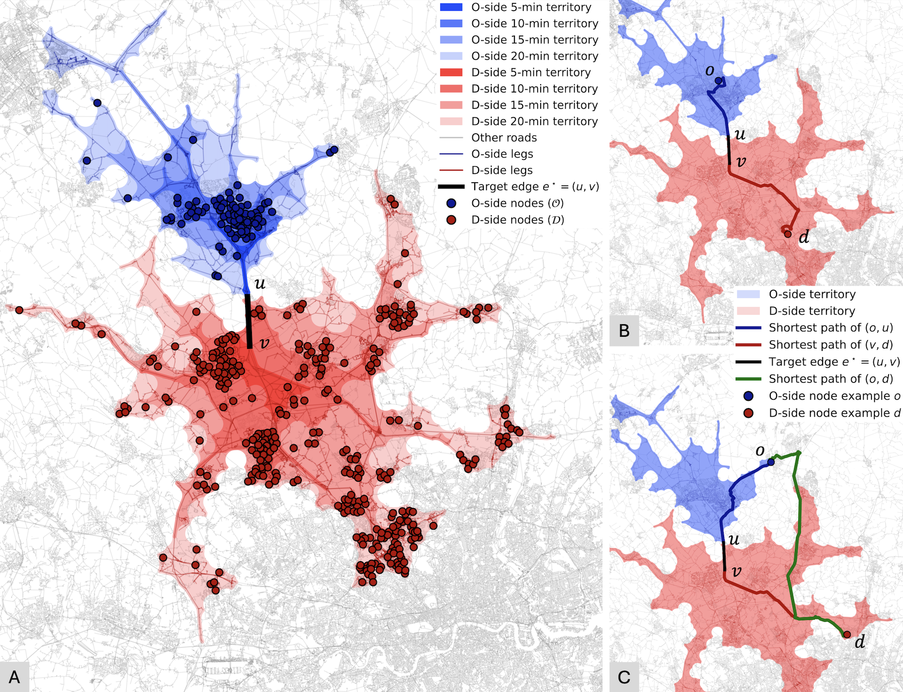
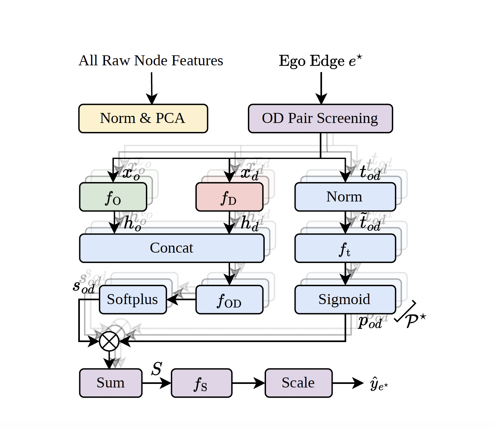

# DeepDemand  
## Interpretable Long-Term Traffic Modelling on National Road Networks Using Theory-Informed Deep Learning

  


DeepDemand is a theory-informed deep learning framework for long-term, interpretable traffic volume modelling on national road networks.  
This repository provides the official PyTorch implementation accompanying the paper:

> **Yue Li**, Shujuan Chen, Akihiro Shimoda, Ying Jin  
> *Interpretable long-term traffic modelling on national road networks using theory-informed deep learning*  
> *Transportation Research Part C: Emerging Technologies*, 194, 106102 (2027). https://doi.org/10.1016/j.trc.2026.106102

DeepDemand integrates behavioural travel-demand theory with neural network modelling of origin–destination (OD) interactions. It enables spatially transferable, policy-relevant traffic forecasting with explicit interpretability at both the OD and network levels.

---

# 1. Reproducibility Requirements

## System Configuration

- **Operating System**: Windows 11  
- **Python Version**: 3.10.15  
- **Hardware**:
  - ≥16 GB RAM  
  - ≥16 GB GPU VRAM (CUDA-enabled GPU recommended)

## Core Dependencies

```
python==3.10.15
numpy==2.2.5
pandas==2.3.1
scipy==1.15.3
scikit-learn==1.7.1
numba==0.62.1
networkx==3.4.2
matplotlib==3.10.0
umap-learn==0.5.9.post2
torch==2.5.1
pytorch-cuda==12.1
torchvision==0.20.1
torchaudio==2.5.1
pyarrow==19.0.0
pyproj==3.6.1
```

A CUDA-compatible GPU is required for efficient training.

---

# 2. Repository Structure

## `data/` — Data Construction Pipeline

This directory contains scripts for constructing the complete modelling dataset:

1. Highway network extraction and simplification  
2. Node-level socioeconomic feature engineering  
3. Local OD region extraction and OD pair screening  
4. Traffic volume aggregation  

> **Important**  
> Raw datasets are not stored in this repository.  
> All primary data sources are open-access and should be downloaded from their official providers.  
> Essential processed datasets used for model training are publicly available via the University of Cambridge Apollo repository (DOI: https://doi.org/10.17863/CAM.127892). 
> Additional large files can be provided upon request.

### `highway_network/`

- Download `great-britain-20250101.osm.pbf` from Geofabrik.
- Use `osmium` to extract a driving-network subset (`uk_highway_only.pbf`).
- `extract_driving_network.ipynb`:
  - Builds a simplified directed graph (`gpickle`)
  - Exports nodes and edges as GeoJSON
- `add_travel_time_to_uk_driving_graph_simplified.ipynb`:
  - Injects travel-time attributes as edge features

---

### `node_features/`

Constructs LSOA-level features:

- Administrative boundaries (ONS)
- Population
- Employment
- Land use
- Points of interest (POI)
- Additional variables (area, density, households, IMD)

`LSOA_node_pairing.ipynb` matches LSOA centroids to graph nodes.

Final feature banks:

- `lsoa21_features_raw.json`
- `lsoa21_features_normalized.json`

---

### `subgraphs/`

Builds, for every target edge, the set of OD pairs whose fastest route uses that edge.

- `build_csr_graph.py` — converts the driving graph to CSR arrays for parallel shortest-path work
- `build_reach_tree.py` — shortest travel times between centroid nodes within a cutoff
- `competitive_partition.py` — competitive origin/destination partition of each edge's local region
- `screen_od_pairs.py` — shortest-path screening, written directly as the per-edge OD index cache

A catchment radius of `tau` requires a reachability cutoff of `2*tau`, since a screened pair
satisfies `t_O + t_e + t_D = t_OD` with both sides bounded by `tau`.

---

### `traffic_volume/`

- Sensor metadata (`Sites.csv`)
- Sensor availability analysis
- Raw traffic data download and processing
- 8-year AADT aggregation
- Final ground truth file:
  - `GT_AADT_8years.json`

---

## `model/` — Model, Ablations and Baselines

- `deepdemand.py` — DeepDemand architecture
- `od_cache.py` — per-edge OD index cache read during training
- `dataloader.py` — data loading utilities
- `utils.py` — metrics and splitting
- `ablation_models.py` — component ablations (shared encoder, constant deterrence, linear aggregation)
- `ablation_od_structure.py` — pooled-zone versus OD-structured features
- `sensitivity_aggregation.py` — sensitivity to the multi-year aggregation of the ground truth
- `baseline_*.py` — mean, OLS, ridge, gravity, random forest, XGBoost, LightGBM, GAT

---

## `eval/` — Evaluation and Diagnostics

- `logs/` — Random CV and spatial CV training logs  
- `baselines/` — Baseline performance outputs  
- `cv.ipynb` — Random CV metric summaries  
- `spatial_cv.ipynb` — Spatial CV summaries  
- `evaluate_log.py` — Log parser  
- `cv_report.py`, `spatial_cv_report.py`, `ablation_report.py` — metric tables across folds  
- Residual analysis and visualisation scripts  

---

## `interpret/` — Interpretability Analysis

- Distance deterrence function analysis  
- UMAP visualisation of node embeddings  
- SHAP-based OD attribution analysis  
- Domain-level and subdomain-level feature importance  
- `od_pair_rf_shap.py` — SHAP protocol wrapper  

---

## Additional Directories

- `param/` — Trained model weights  
- `projection/` — Long-term projection scripts (e.g., 2040 scenarios)  
- `config.py` — Hyperparameter configuration  
- `train.py` — Random cross-validation training  
- `train_spatial_cv.py` — Spatial cross-validation training  
- `run_cv.sh`, `run_spatial_cv.sh`, `run_baselines.sh`, `run_ablation.sh` — fold and experiment drivers  

---

# 3. Workflow

## Preprocessing

```bash
python data/subgraphs/build_csr_graph.py
python data/subgraphs/build_reach_tree.py --cutoff 7200 --out data/subgraphs/reach_2h
python data/subgraphs/competitive_partition.py --build-transpose
python data/subgraphs/competitive_partition.py --run --cutoff 3600 \
    --out data/subgraphs/subgraphs --workers 8
python data/subgraphs/screen_od_pairs.py --run --meta data/subgraphs/subgraphs --tau 3600 \
    --out data/subgraphs/od_index_cache --workers 8
```

`--workers` should be set to the number of available cores. Pass `--emit-od-use` to the final
step to also export the per-edge OD pair table, which the feature-based baselines read.

## Training

```bash
python train.py                 # random cross-validation
python train_spatial_cv.py      # spatial cross-validation
```

`CV_TYPE`, `CV_FOLD` and `RUN_NAME` select the protocol, the held-out fold and the output name.
`MODEL_VARIANT` selects a component ablation. The driver scripts run the full set of folds:

```bash
bash run_cv.sh
bash run_spatial_cv.sh
bash run_baselines.sh
bash run_ablation.sh
```

---

# 4. Data Availability

- **Raw data**: Obtain directly from official open-data providers (e.g., OSM, ONS, National Highways).
- **Processed training data**: Hosted on the University of Cambridge Apollo repository.
- **Large supplementary files**: Available upon request.

For methodological transparency, full reproduction from raw data is encouraged.

---

# 5. Citation

If you use DeepDemand in your research, please cite:

```bibtex
@article{LiEtAl2027,
  author  = {Li, Yue and Chen, Shujuan and Shimoda, Akihiro and Jin, Ying},
  title   = {Interpretable long-term traffic modelling on national road networks using theory-informed deep learning},
  journal = {Transportation Research Part C: Emerging Technologies},
  year    = {2027},
  volume  = {194},
  pages   = {106102},
  doi     = {10.1016/j.trc.2026.106102}
}
```

---

# 6. License

This project is licensed under the MIT License. See the `LICENSE` file for details.

---

DeepDemand bridges theory-driven travel demand modelling and modern deep learning, enabling interpretable, scalable, and policy-relevant national-scale traffic forecasting.